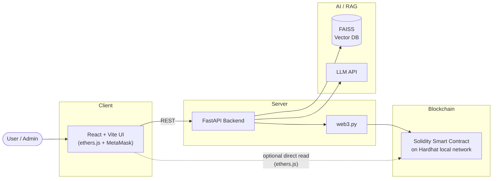
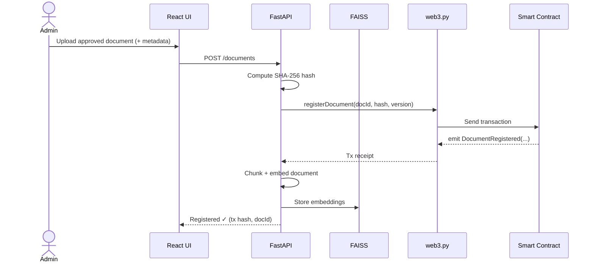
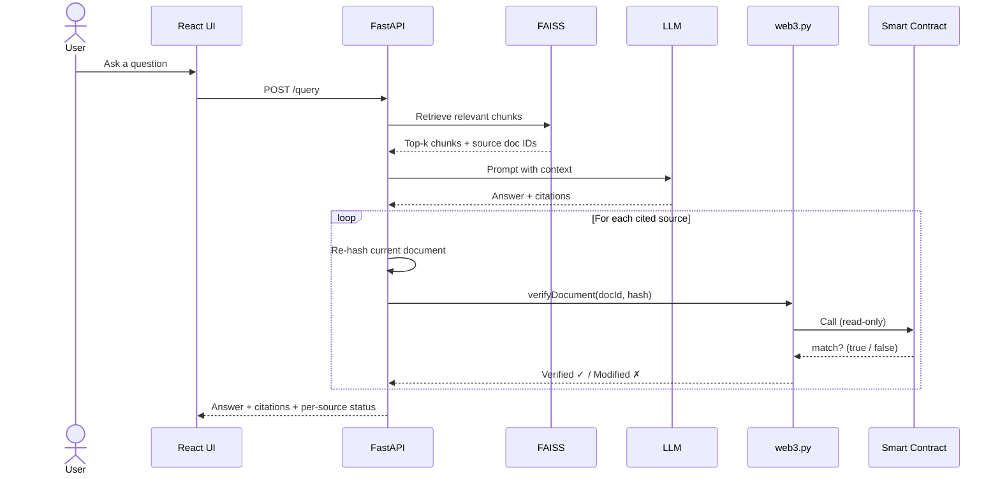

# VeriRAG

**Blockchain-Verified Source Integrity for AI Chatbots**

> Prove that the documents behind an AI answer haven't been tampered with — by anchoring their cryptographic fingerprints on-chain.

-61DAFB?logo=react&logoColor=white)


> **Project status: Early planning.** Nothing is implemented yet. Throughout this
> README, features are explicitly marked **Planned** vs **Implemented**. At this stage,
> **everything is Planned.**

---

## Overview

VeriRAG is a Retrieval-Augmented Generation (RAG) chatbot that adds a verifiable
**source-integrity layer** on top of a conventional document QA system. When the chatbot
cites a source document in its answer, VeriRAG re-checks that document's cryptographic
hash against a tamper-evident record stored on a blockchain, and tells the user whether
the source is still **Verified ✓** or has been **Modified ✗** since it was approved.

This is a university term project for the course **Blockchain Technology and
Applications**, University of Management and Technology (UMT) Lahore, School of
Artificial Intelligence, Department of AI/DS — **Group 9**.

### Problem

Enterprise RAG chatbots answer questions from internal documents — HR policies, legal
contracts, medical protocols, standard operating procedures. These answers influence
real decisions, yet **nobody can prove the source documents behind an answer weren't
altered after they were approved.**

A normal database row can be silently edited by any administrator with access. There is
no independent, tamper-evident trail showing that the "approved version" an employee
relied on is the same bytes that were originally signed off. If a policy is quietly
changed, the chatbot will happily cite the altered version with full confidence.

### Solution

VeriRAG separates **content** (kept off-chain) from **integrity proof** (anchored
on-chain):

1. **Registration.** An admin uploads an approved document. The backend computes its
   **SHA-256 hash** and registers the hash plus metadata (document ID, version,
   uploader, timestamp) on-chain via a Solidity smart contract.
2. **Ingestion.** The document is chunked, embedded, and stored in a vector database so
   it can be retrieved for RAG.
3. **Query + verification.** A user asks a question. The chatbot answers **with
   citations**. For each cited source, the backend **re-hashes** the current document and
   compares it against the on-chain record. The UI then shows **Verified ✓** (hash
   matches) or **Modified ✗** (hash differs).
4. **Audit.** An audit-log page shows the on-chain history of document registrations and
   updates, independently of the application database.

Only **hashes and metadata** go on-chain. **Document content never leaves off-chain
storage**, which keeps sensitive material private while still making integrity publicly
verifiable.

---

## Architecture

> **Planned.** The diagram below describes the intended system; no components are built yet.



---

## Workflows

> **Planned.** Sequence diagrams describe the intended flows.

### (a) Document Registration



### (b) Query + Verification



---

## Smart Contract

> **Planned.** The interface below is a design sketch and is subject to change.

A single registry contract is planned, storing one record per document ID.

| Function | Description |
| --- | --- |
| `registerDocument(string docId, bytes32 hash, uint256 version)` | Register (or add a new version of) a document's hash and metadata. |
| `getDocument(string docId)` | Return the latest stored record (hash, version, uploader, timestamp) for a document. |
| `verifyDocument(string docId, bytes32 hash)` | Return `true` if the supplied hash matches the latest on-chain record, else `false`. |

**Event (planned):**

```solidity
event DocumentRegistered(
    string  indexed docId,
    bytes32 hash,
    uint256 version,
    address indexed uploader,
    uint256 timestamp
);
```

Records are intended to be **append-only** — new versions are added, not overwritten —
so the full history remains auditable on-chain.

---

## Why Blockchain vs a Conventional Database

A blockchain is **not** a faster or cheaper database. We use it only for the narrow job of
**tamper-evident integrity proofs**. The comparison below explains the trade-off.

| Property | Conventional Database | Blockchain (VeriRAG) |
| --- | --- | --- |
| **Tamper-evident** | No — rows can be edited in place with no trace | Yes — altering a record breaks the chain / is detectable |
| **Append-only history** | Only if deliberately enforced; still bypassable by an admin | Yes — by design |
| **Independently verifiable** | No — you must trust the database operator | Yes — anyone can verify a hash against the ledger |
| **Single admin can rewrite history** | Yes | No — no single party can silently rewrite past records |
| **Stores document content** | Yes | No — only hashes + metadata (content stays off-chain) |
| **Cost per write** | Negligible | Gas cost per transaction |

### Limitations (stated honestly)

- **Gas / cost.** Every on-chain write costs gas. On a public network this adds real,
  recurring cost; this prototype avoids that by using a local chain.
- **Privacy.** Hashes and metadata are public on-chain. Document IDs and timestamps may
  leak information even though content stays off-chain.
- **Integrity, not truthfulness.** VeriRAG proves a document is **unchanged since it was
  registered**. It does **not** prove the document was correct, accurate, or truthful in
  the first place.
- **Garbage-in.** If a wrong document is registered, VeriRAG will faithfully verify the
  wrong document.
- **Local chain only.** This prototype targets a **local Hardhat network**. It is not
  deployed to a public testnet or mainnet.

---

## Tech Stack

| Layer | Technologies |
| --- | --- |
| **Frontend** | React (Vite), Tailwind CSS, ethers.js, MetaMask |
| **Backend** | FastAPI (Python), web3.py |
| **AI / RAG** | LangChain, FAISS, sentence embeddings, an LLM API |
| **Blockchain** | Solidity, Hardhat (local Ethereum network) |

---

## Project Structure

```
verirag/
├── frontend/     # React (Vite) + Tailwind UI, ethers.js + MetaMask  [Planned]
├── backend/      # FastAPI service, web3.py, RAG pipeline             [Planned]
├── contracts/    # Solidity contracts + Hardhat project               [Planned]
├── docs/         # Report, diagrams, poster, design notes             [Planned]
├── README.md
└── .gitignore
```

---

## Getting Started

> **Planned.** These are placeholder setup steps. Commands and scripts do not exist yet
> and will be filled in as each component is implemented.

### Prerequisites (planned)

- Node.js 18+ and npm
- Python 3.10+
- MetaMask browser extension
- An LLM API key

### 1. Smart contracts (Hardhat)

```bash
cd contracts
npm install
npx hardhat compile
npx hardhat node          # start local Ethereum network
npx hardhat run scripts/deploy.js --network localhost
```

### 2. Backend (FastAPI)

```bash
cd backend
python -m venv .venv
source .venv/bin/activate        # Windows: .venv\Scripts\activate
pip install -r requirements.txt
cp .env.example .env             # add LLM API key, contract address, RPC URL
uvicorn app.main:app --reload
```

### 3. Frontend (React + Vite)

```bash
cd frontend
npm install
cp .env.example .env             # add backend URL, contract address
npm run dev
```

---

## Roadmap

| Phase | Milestone | Target Date |
| --- | --- | --- |
| **Phase 1** | Topic Proposal | Nov 3, 2026 |
| **Phase 2** | Prototype | Dec 8, 2026 |
| **Phase 3** | Report | Dec 22, 2026 |
| **Phase 4** | Poster | 1st week of Jan 2027 |

---

## Contributing / Git Workflow

To keep `main` stable, **never push directly to `main`.** All work happens on feature
branches and is merged through a reviewed pull request.

**Branch naming:** `frontend/<feature>`, `backend/<feature>`, or `contracts/<feature>`.

**Workflow:**

1. Create a branch off the latest `main`.
2. Commit your work with clear messages.
3. Push the branch and open a pull request.
4. The **team lead reviews and merges** the PR into `main`.

**Example:**

```bash
# start from an up-to-date main
git checkout main
git pull origin main

# create a feature branch
git checkout -b frontend/document-upload-ui

# work, then stage and commit
git add .
git commit -m "feat(frontend): add document upload form"

# push the branch and open a PR
git push -u origin frontend/document-upload-ui
# then open a pull request on GitHub for the team lead to review
```

Please keep pull requests focused and small where possible, and reference the related
task or phase in the description.

---

## Team — Group 9

UMT Lahore · School of AI · Department of AI/DS

| Name | Student ID | GitHub | Role |
| --- | --- | --- | --- |
| M. Faizan Haider (Lead) | S2024332017 | [@Faizanhaider013](https://github.com/Faizanhaider013) | Team Lead, AI/RAG & Backend |
| Shehzaib Mirza | S2024332016 | [@Shehzaib17](https://github.com/Shehzaib17) | Frontend (React UI) |
| Hassan Mujtaba | S2024332014 | [@claw751](https://github.com/claw751) | Smart Contracts (Solidity/Hardhat) |
| Ali Zain | S2024332034 | TBD | Integration, Testing & Documentation |

---

## Data Note

This project uses **only synthetic or publicly available data**. No real, private, or
confidential documents are used for development, testing, or demonstration.

---

## License

Released under the [MIT License](LICENSE).
